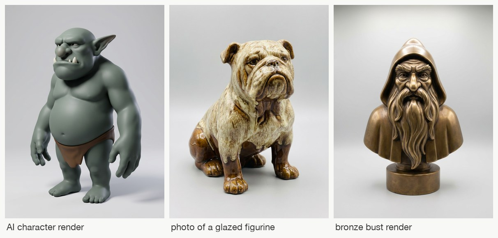

# Image 2 Sculpt

**Turn one image of anything into a 3D sculpt that is measured against that image.** A skill for coding agents
(Claude Code, Codex, Cursor, Copilot, Gemini) that fits a watertight sculpt to the image's own normals, outline
and depth in the image's own camera, completes the unseen sides from generated views that must first agree with
each other, and records every step of the build so Blender can replay it as a timelapse.

The next step after [Video 2 GLSL](https://github.com/gokayfem/shader-skills),
[Video 2 Blender Nodes](https://github.com/gokayfem/video-to-blender),
[Video 2 Physics](https://github.com/gokayfem/video-to-physics) and
[Video to CSS](https://github.com/gokayfem/video-to-css). Those rebuild how a clip looks, moves and animates.
This one rebuilds the shape of what is in a picture, and shows the work.

## Why

Ask an agent for "a 3D model of this" and it either calls a black-box image-to-3D model or sculpts blind. Either
way nobody can say how well the result matches the picture, and the usual failures go unnoticed:

- the back of the subject is invented, and nothing checks it against anything;
- generated side views are trusted at the angle that was asked for, though they are rarely there (views asked
  for at +45°, +90° and −90° were really at +20°, −115° and +35° on the first case this was built on);
- one bad generation (a changed pose, an extra limb) cuts real volume out of the model;
- normals from different images are averaged, and noses, brows and knuckles flatten;
- the surface turns into voxel staircases, moiré rings or webs between arm and body after a few edits;
- the process is invisible: one mesh appears, with no record of how it got there.

This toolkit gives the agent a method and the tools to do it properly:

- **The photo fixes what it sees.** MoGe gives its focal length and metric depth, Marigold its normals, BiRefNet
  (or the alpha channel, or a SAM-3 text prompt) its mask. Where the photo sees a surface, the photo governs.
- **Generated views are registered and screened, never trusted.** Each view's camera is found by search, not
  taken from the prompt: left/right swaps are found, front/back is kept. A view that disagrees with the hull of
  the others is rejected with its reason recorded.
- **One view is held out.** Its camera is frozen before fitting and it never moves the surface; it is reported
  apart from the views used to fit.
- **Many small, recorded passes.** A visual hull, then forms → surface → detail: per-vertex targets from every
  view's normals and outline and the photo's depth, symmetric targets where the subject has a mirror plane, a
  stiff solve for outlines and a flexible one for normals. Then a silhouette cut to open gaps, an opening to
  remove webs, polish passes. Each pass is a step in `build/steps/`.
- **The volume stays exact.** An exact signed distance field after every operation: no staircases, no rings.
- **Every map is checked.** For every view: silhouette IoU, outline distance, normal angle, roughness against the
  reference's own roughness, and the photo's depth, side by side on a map sheet. Never one "quality" number.
- **Blender replays the build.** Every recorded step rendered from the photo's camera, a 360° turntable, the
  sculpt from every view's camera, a `.blend` with the photo as the camera background, and GLB/OBJ/STL.

## Any input

<p align="center"></p>

<p align="center"><sub>Three inputs the toolkit was developed on: an AI character render, a photo of a glazed figurine (reflective), a bronze bust render. One pipeline, no per-subject code.</sub></p>

| Input | What happens |
|---|---|
| An AI image or a 3D render of a character, creature, figurine or product | the main path |
| A photo of a real object (figurine, toy, statue, product) | MoGe's metric focal length and depth anchor the scale |
| A cut-out PNG with transparency | the alpha channel is the mask; no mask call |
| A busy image with several things in it | `prep --select "the red dragon"`: SAM-3 picks the subject |
| A drawing, sketch or flat illustration | `prep --restyle`: turned into a 3D render first, same pose and silhouette |
| Several photos of the same object | `views --import DIR`: they replace generated views; angles from file names or found by registration |
| Only an idea | `imagine OUT.png "idea"` makes a clean full-figure image to start from |
| No API key | a cut-out PNG plus your own views; front-only works too (an inflated silhouette, depth guessed) |

Any aspect ratio and size: the input is padded (never cropped) to the nearest aspect ratio the view generator
supports, so every view shares one lens. Units are normalised to the subject, so every tolerance transfers from a
2 cm figurine photo to a 2 m statue render. Scenes and rooms, hair-thin structures and transparent or mirror
materials are out of scope, and the skill says so before starting.

## Install

**Claude Code** (plugin marketplace):

```bash
claude plugin marketplace add gokayfem/image-to-sculpt
```

```bash
claude plugin install image-to-sculpt@image-to-sculpt
```

Or copy the skill: `cp -R skills/image-to-sculpt ~/.claude/skills/`.

**Codex, Cursor, Gemini CLI, Copilot and other agents** (via [skills](https://github.com/vercel-labs/skills)):

```bash
npx skills add gokayfem/image-to-sculpt
```

Or install by hand:

- **Codex:** copy `skills/image-to-sculpt` to `~/.agents/skills/`.
- **Cursor:** copy it to `~/.cursor/skills/`, plus the rule in `adapters/cursor/`.
- **Copilot:** `gh skill install gokayfem/image-to-sculpt image-to-sculpt`, plus `adapters/copilot/`.
- **Gemini CLI:** `gemini extensions install https://github.com/gokayfem/image-to-sculpt`.

**claude.ai:** zip `skills/image-to-sculpt` and upload it under Settings > Capabilities > Skills.

**ChatGPT, Gemini Gems and other chat tools:** see [`adapters/`](adapters/).

Requirements: Python 3.10+ with `numpy`, `scipy`, `scikit-image` and `Pillow` (`pip install -r requirements.txt`
adds `fal-client` and `matplotlib`), Blender 5.2+ (`$BLENDER`, `blender` on PATH, or the macOS app) and `ffmpeg`
for the replay and films, and a fal API key in `FAL_KEY` for masks, depth, normals and generated views.
`python3 skills/image-to-sculpt/scripts/i2s.py doctor` checks all of it (the key is never printed).

## Use

Ask naturally, for example:

- *"Sculpt this figurine in 3D: `owl.jpg`."*
- *"Turn this character render into a printable model and show me how it was built."*
- *"Here are four photos of my statue. Make a mesh that matches them."*
- *"How well does this model match the concept art? Check it."*

The agent scaffolds a case, posts a labelled sheet at every checkpoint, and runs the stages:

```bash
python3 skills/image-to-sculpt/scripts/i2s.py new cases/owl --input owl.jpg --subject "carved wooden owl figurine"
python3 skills/image-to-sculpt/scripts/i2s.py run cases/owl
```

`run` does everything after `new`. Each stage also runs on its own:

| Command | What it does |
|---|---|
| `new` | scaffold a case: the input copied with its sha256, padded to a generator aspect ratio, contract and targets |
| `prep` | front maps: mask, metric depth and focal length, normals; units normalised to the subject |
| `views` | generated views (9 + 1 held out by default) with masks and normals, or `--import` your own |
| `parts` | front-image regions from text prompts ("hands", "face") or boxes, for focused passes |
| `hull` | register every view, re-centre, screen, carve the visual hull (every cut recorded), find the mirror plane |
| `fit` | recorded map-fit passes: `forms`, `surface`, `detail`, `polish`, or `focus --region R` |
| `cut`, `smooth` | open gaps the views show; remove webs, flaps and specks (optionally in a region) |
| `check` | the map sheet and metrics for every view, the held-out view included |
| `finish`, `blender`, `film` | final surface; Blender replay, turntable and views; timelapse, turntable, views sheet, hero image |
| `report` | `REPORT.md`, the per-step chart and a static review page |
| `demo` | the whole pipeline offline on a synthetic subject with known shape |

Every paid call goes through a per-case budget (`--budget`, estimated per call) and its request id is written to
`case.json` before the result is awaited. A typical case costs about $2: 10 generated views with their masks and
normals, plus the photo's depth, normals and mask.

## How a case runs

| Phase | Deliverable | Checked by |
|---|---|---|
| Scaffold | `case.json`, `CONTRACT.md`, `acceptance.json`, the padded working image | written before any view exists |
| Front maps | mask, metric depth, focal length, normals | a person looks at the mask and normal map |
| Views | generated or imported views with masks and normals | a person looks at every view; screening |
| Hull | registered cameras, the recorded carve, the mirror plane | IoU of every view against the hull of the others |
| Fit | 38 recorded passes, a silhouette cut, an opening, 4 polish passes | every view's maps, every pass; the held-out view |
| Check | map sheets, metrics per view | the targets in `acceptance.json`; a person reads the sheets |
| Blender | replayed steps, turntable, view renders, `.blend`, GLB/OBJ/STL | the views sheet: each view beside the sculpt from its camera |
| Deliver | timelapse ending in a 360° turn, report, review page | a person decides whether to iterate |

The timelapse puts the reference beside the sculpt for every recorded step, from the first block through each
carve and pass, holds on the result, then turns the finished sculpt a full 360°. Its first frame is a finished
thumbnail.

## Verification

| Check | Where | What it proves |
|---|---|---|
| Cameras and rasteriser | `tests/test_geom.py` | projection round trips, orbits about the centre, rigid Blender cameras; a rasterised sphere matches the analytic depth (0.1/1000) and normals (0.3°) |
| Distance fields | `tests/test_sdf.py` | fields stay exact (median 0.07 voxel, gradient norm 1); offsets move the surface by exactly the offset; opening removes a one-voxel web and keeps the ball; resampling keeps the surface |
| Registration | `tests/test_register.py` | a view asked for at 30° but taken at 72° is found at 72.0°; a back view stays a back view; a symmetric subject seen from behind and above is not taken for its front from below; the mirror plane is found at any yaw (25.0° for 25°); a changed pose scores 0.68 against 0.98 for a consistent view |
| End to end | `tests/test_pipeline.py` (`--slow`) | a synthetic figure with views 10° off their asked angles, noisy normals and one view with the arms raised: the bad view is rejected, every camera is recovered, the fit ends closer to the true shape than the hull, the held-out view agrees |

```bash
python3 tests/run_tests.py           # fast tests (~1 min)
python3 tests/run_tests.py --slow    # + the end-to-end pipeline
```

CI (`.github/workflows/checks.yml`) runs both on Linux without fal, Blender or ffmpeg.

## Layout

```text
skills/image-to-sculpt/   the skill: SKILL.md, references/, templates/, scripts/ (i2s CLI, library, Blender script)
tests/                    python3 tests/run_tests.py [--slow] (synthetic subjects with known shape)
adapters/                 prompts for assistants without skill support
gallery/                  README input images
```

Cases and everything they produce live outside the repository (`cases/` is git-ignored).

## Credits

See [CREDITS.md](CREDITS.md). MIT licensed.
